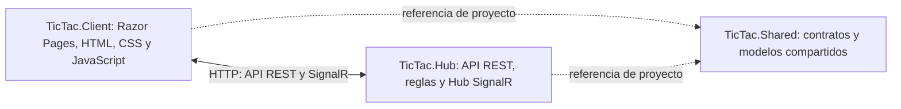

# TicTacToe en tiempo real con SignalR

Juego de tres en raya para dos jugadores. El servidor valida los movimientos y SignalR comunica los cambios a los clientes conectados a la partida. Incluye una segunda pagina para demostrar notificaciones de pedidos en tiempo real, como pide el reto del taller.

## Arquitectura

La solucion mantiene los tres proyectos del taller:



- **TicTac.Client:** presenta el tablero y las paginas web. El navegador usa el cliente JavaScript de SignalR.
- **TicTac.Hub:** aloja la API REST, el Hub `PartidaHub`, `PartidaService` y `PedidoService`.
- **TicTac.Shared:** contiene contratos y modelos compartidos por los proyectos .NET, incluido `OrderNotification`.

## Requisitos

- .NET 10 SDK.
- Una terminal en la carpeta raiz del repositorio.
- Library Manager (LibMan) para descargar el cliente JavaScript de SignalR.

## Restaurar y compilar

Desde la raiz:

```powershell
dotnet restore TicTac.sln
dotnet build TicTac.sln
```

Instala LibMan una vez si todavia no esta disponible:

```powershell
dotnet tool install -g Microsoft.Web.LibraryManager.Cli
```

Si ya esta instalado, puedes actualizarlo:

```powershell
dotnet tool update -g Microsoft.Web.LibraryManager.Cli
```

Restaura la biblioteca JavaScript declarada por `TicTac.Client/libman.json`:

```powershell
cd TicTac.Client
libman restore
cd ..
```

Comprueba que exista `TicTac.Client/wwwroot/js/signalr/dist/browser/signalr.min.js`. Las paginas intentan usar esa ruta local y tienen un respaldo de CDN para la demostracion.

## Ejecutar en una computadora

Abre dos terminales desde la raiz.

Terminal 1, servidor:

```powershell
dotnet run --project TicTac.Hub/TicTac.Hub.csproj --no-launch-profile --urls http://0.0.0.0:7001
```

Terminal 2, cliente web:

```powershell
dotnet run --project TicTac.Client/TicTac.Client.csproj --no-launch-profile --urls http://localhost:7002
```

Abre el juego en [http://localhost:7002](http://localhost:7002). La pagina de notificaciones esta en [http://localhost:7002/Pedidos](http://localhost:7002/Pedidos).

## Jugar desde dos dispositivos en la misma red

1. Ejecuta el servidor y el cliente en la computadora que alojara el juego.
2. En Windows, ejecuta `ipconfig` y localiza la direccion IPv4 de esa computadora.
3. Permite conexiones entrantes en el firewall para los puertos TCP 7001 y 7002, si Windows lo solicita.
4. En el segundo dispositivo conectado a la misma red, abre `http://IP-DE-LA-PC:7002`, reemplazando el texto por la IPv4 real.
5. Ambos jugadores usan el mismo codigo de partida. Uno elige X y el otro O.

El cliente usa el nombre de host de la pagina y el puerto 7001 para llamar a la API y al Hub. La configuracion es para pruebas en una red local; no publica el juego en Internet. CORS permite origenes cuyo puerto sea 7002 para facilitar el taller. En produccion se deben configurar origenes concretos y usar HTTPS.

## Como funciona SignalR en este proyecto

- `MapHub<PartidaHub>("/partidaHub")` publica el Hub.
- `invoke()` permite al cliente llamar a `UnirsePartida`.
- `on()` registra los manejadores de eventos que llegan del servidor.
- `Groups.AddToGroupAsync()` y `Clients.Group()` limitan los cambios del juego a los clientes de la partida.
- `withAutomaticReconnect()` y los manejadores de reconexion permiten al cliente intentar recuperar la conexion.
- Las reglas importantes se validan en el servidor; no se confia solamente en los controles del navegador.
- `TicTac.Shared` define los contratos para evitar que los proyectos .NET tengan definiciones duplicadas.

## Endpoints

| Metodo | Ruta | Funcion |
|---|---|---|
| POST | `/api/Partidas/{partidaId}/entrar` | Registrar X u O en una partida |
| POST | `/api/Movimientos` | Validar y registrar un movimiento |
| GET | `/api/Movimientos/{partidaId}` | Consultar movimientos |
| POST | `/api/Pedidos/{pedidoId}/estado` | Validar el siguiente estado y emitir una notificacion |
| SignalR | `/partidaHub` | Conexion en tiempo real |

## Reto del taller: notificaciones de pedidos

Abre `/Pedidos` en dos pestañas o navegadores. Usa el mismo codigo de pedido y avanza los estados en orden: **Pendiente → En preparación → Enviado → Entregado**. El estado inicial se considera `Pendiente`; la primera actualizacion valida es `En preparación`.

El contrato compartido `OrderNotification` incluye el codigo del pedido, el nuevo estado y la fecha UTC de la notificacion. El cliente registra `connection.on("PedidoActualizado", ...)` y muestra cada cambio sin recargar la pagina. La API REST valida el estado y luego usa `Clients.All` para difundir el evento en esta demostracion.

La validacion del servidor rechaza codigos vacios o demasiado largos, estados desconocidos y saltos o retrocesos en el flujo. El estado de los pedidos se guarda en memoria, igual que las partidas, por lo que se pierde al reiniciar el servidor. Para una aplicacion real, guarda pedidos y estados en una base de datos y emite la notificacion despues de confirmar la transaccion.

**Importante:** `Clients.All` se utiliza aqui para demostrar el evento del taller. En un sistema real con pedidos privados, autentica al usuario y limita las notificaciones a `Clients.User()` o a grupos autorizados; no difundas informacion de clientes a todos los conectados.

## Validaciones del juego

- Codigo de partida y jugador validos.
- Maximo de dos jugadores, X y O.
- Turno correcto.
- Fila y columna dentro del tablero.
- Casilla libre.
- Partida en curso y sin movimientos despues de terminar.
- Deteccion de ganador o empate.

## Autenticacion y autorizacion: propuesta

Esta version didactica **no implementa inicio de sesion ni autenticacion real**. Elegir X u O no demuestra la identidad del jugador. Para integrarlas en una aplicacion real:

1. Configurar autenticacion con ASP.NET Core Identity y cookies, o con un proveedor de identidad y tokens.
2. Configurar `AddAuthentication`, `AddAuthorization` y los middleware correspondientes.
3. Proteger endpoints y hubs con `[Authorize]` o politicas de autorizacion.
4. Asociar la partida y el jugador con la identidad autenticada en el servidor; no confiar en un nombre o marca enviada por el navegador.
5. Verificar que cada usuario tenga permiso para entrar a la partida y recibir sus notificaciones.
6. Usar `Clients.User()` solo cuando la identidad del destinatario este establecida de forma confiable.

Esta propuesta documenta el tema solicitado por el taller sin fingir que el proyecto ya tiene autenticacion implementada.

## Pruebas manuales y evidencias

Consulta [docs/PRUEBAS.md](docs/PRUEBAS.md). Ejecuta las pruebas y cambia el resultado real solo despues de comprobar cada caso. Guarda capturas reales de dos clientes, un movimiento sincronizado, el final de una partida y las notificaciones de pedidos recibidas en dos pestañas. No se incluyen capturas inventadas ni se declara una demostracion como aprobada antes de ejecutarla.

## Entregables

- [x] Tres proyectos: Client, Hub y Shared.
- [x] API REST integrada con SignalR.
- [x] Validaciones del lado servidor para el juego y el flujo de estados de pedidos.
- [x] Contrato `OrderNotification` en Shared.
- [x] Evento `PedidoActualizado` y pagina que muestra cambios sin recargar.
- [x] README con arquitectura, ejecucion y propuesta de autenticacion/autorizacion.
- [x] Diagrama de arquitectura y lista de pruebas manuales.
- [ ] Ejecutar y verificar las pruebas en dos clientes.
- [ ] Adjuntar capturas reales y completar la demostracion funcional.

## Limites conocidos

Las partidas y los pedidos se guardan en memoria. Al reiniciar el servidor se pierde su estado. La autenticacion/autorizacion se describe como propuesta, pero no se implementa en esta version del taller.
