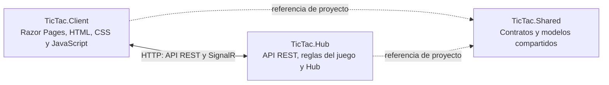

# TicTacToe en tiempo real con SignalR

Juego de tres en raya para dos jugadores. El servidor valida los movimientos y SignalR comunica los cambios a los clientes conectados a la partida.

## Arquitectura

La solucion mantiene los tres proyectos que se trabajan en el taller:



- **TicTac.Client:** presenta el tablero y usa el cliente JavaScript de SignalR. El navegador recibe JSON; no ejecuta las clases C# de Shared.
- **TicTac.Hub:** aloja la API REST, el Hub `PartidaHub` y `PartidaService`, que valida turnos y movimientos.
- **TicTac.Shared:** contiene los modelos que se comparten entre los proyectos .NET.

## Requisitos

- .NET 10 SDK.
- Una terminal en la carpeta raíz del repositorio.
- Library Manager (LibMan) para descargar el cliente JavaScript de SignalR.

## Restaurar y compilar

Desde la raíz:

```powershell
dotnet restore TicTac.sln
dotnet build TicTac.sln
```

Instala LibMan una vez si todavía no está disponible:

```powershell
dotnet tool install -g Microsoft.Web.LibraryManager.Cli
```

Si ya está instalado, actualízalo cuando sea necesario:

```powershell
dotnet tool update -g Microsoft.Web.LibraryManager.Cli
```

Restaura la biblioteca JavaScript que declara `TicTac.Client/libman.json`:

```powershell
cd TicTac.Client
libman restore
cd ..
```

Comprueba que exista `TicTac.Client/wwwroot/js/signalr/dist/browser/signalr.min.js`. La página depende de esa ruta.

## Ejecutar en una computadora

Abre dos terminales desde la raíz del repositorio.

Terminal 1, servidor:

```powershell
dotnet run --project TicTac.Hub/TicTac.Hub.csproj --no-launch-profile --urls http://0.0.0.0:7001
```

Terminal 2, cliente web:

```powershell
dotnet run --project TicTac.Client/TicTac.Client.csproj --no-launch-profile --urls http://0.0.0.0:7002
```

Abre [http://localhost:7002](http://localhost:7002) en el navegador.

## Jugar desde dos dispositivos en la misma red

1. Ejecuta el servidor y el cliente en la computadora que alojará el juego.
2. En Windows, ejecuta `ipconfig` y localiza la dirección IPv4 de esa computadora.
3. Permite conexiones entrantes en el firewall para los puertos TCP 7001 y 7002, si Windows lo solicita.
4. En el segundo dispositivo conectado a la misma red, abre `http://IP-DE-LA-PC:7002`, reemplazando el texto por la IPv4 real.
5. Ambos jugadores usan el mismo código de partida. Uno elige X y el otro O.

El cliente obtiene el nombre de host de la página y usa el puerto 7001 para llamar a la API y al Hub. Esta configuración es para pruebas en una red local; no publica el juego en Internet. La política CORS del servidor permite orígenes cuyo puerto sea 7002 para facilitar la práctica. En producción se deben configurar orígenes concretos y usar HTTPS.

## Endpoints

| Método | Ruta | Función |
|---|---|---|
| POST | `/api/Partidas/{partidaId}/entrar` | Registrar X u O en una partida |
| POST | `/api/Movimientos` | Validar y registrar un movimiento |
| GET | `/api/Movimientos/{partidaId}` | Consultar los movimientos |
| SignalR | `/partidaHub` | Conexión en tiempo real |

El cliente invoca `UnirsePartida`. El servidor emite los eventos `EstadoPartida` y `MovimientoActualizado` a los clientes de la partida correspondiente. El JavaScript usa `on()` para recibir eventos e `invoke()` para llamar al método del Hub.

## Validaciones que realiza el servidor

- Código de partida y jugador válidos.
- Máximo de dos marcas de jugador, X y O.
- Turno correcto.
- Fila y columna dentro del tablero.
- Casilla no ocupada.
- La partida debe estar en curso.
- No se aceptan movimientos después de terminar la partida.
- Se detecta ganador o empate.

## Pruebas manuales

La lista de pruebas y sus resultados se encuentra en [docs/PRUEBAS.md](docs/PRUEBAS.md). Ejecuta las pruebas y guarda capturas reales de ambos clientes para completar la entrega. No se incluyen capturas de una ejecución que todavía no se haya realizado en este entorno.

## Autenticación, autorización y límites

El taller pide proponer cómo se integrarían autenticación y autorización. En esta versión, seleccionar X u O no demuestra la identidad del jugador; todavía no hay inicio de sesión ni autorización basada en usuarios autenticados. Para una aplicación real, la identidad debe verificarse en el servidor y cada jugador debe tener permiso para entrar y jugar en su partida.

Las partidas se guardan en memoria. Al reiniciar el servidor, se pierden las partidas activas y sus movimientos. No hay persistencia en una base de datos.

## Entregables del taller

- [x] Código fuente organizado en tres proyectos.
- [x] README con arquitectura e instrucciones de ejecución.
- [x] Diagrama de arquitectura.
- [x] Lista de pruebas manuales.
- [ ] Capturas de ejecución real.
- [ ] Demostración funcional ejecutada y verificada.

Las capturas y la demostración deben completarse después de ejecutar el proyecto en los dispositivos de prueba.
